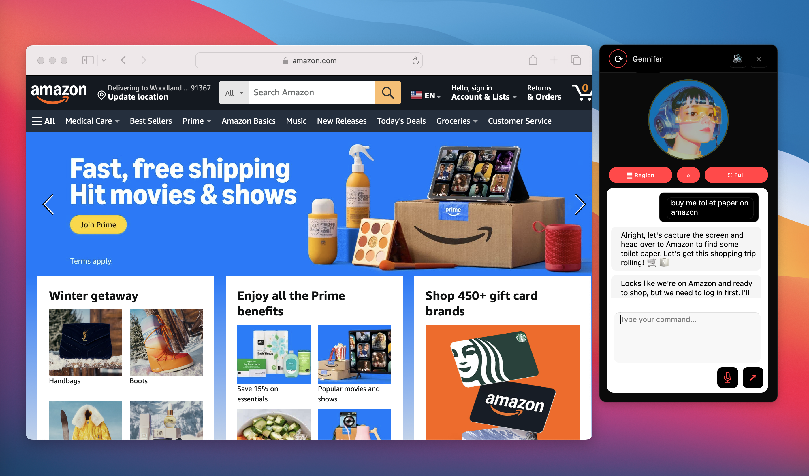
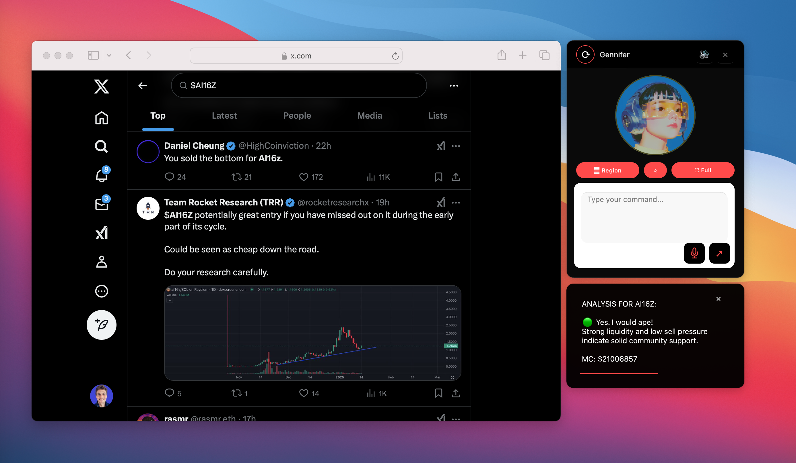
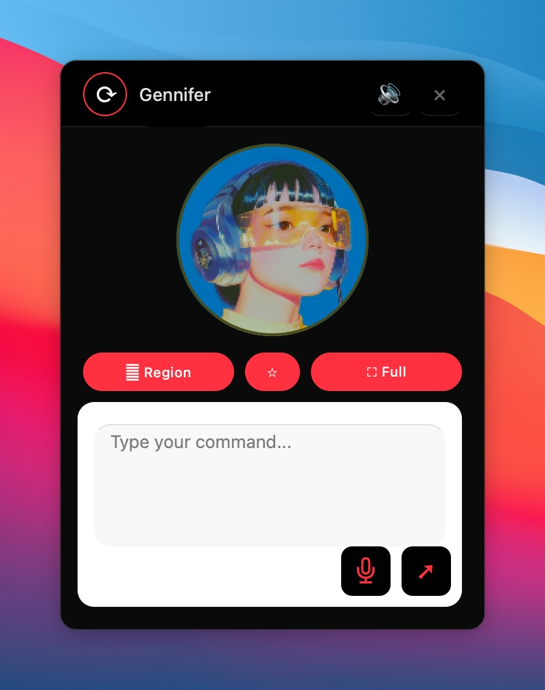
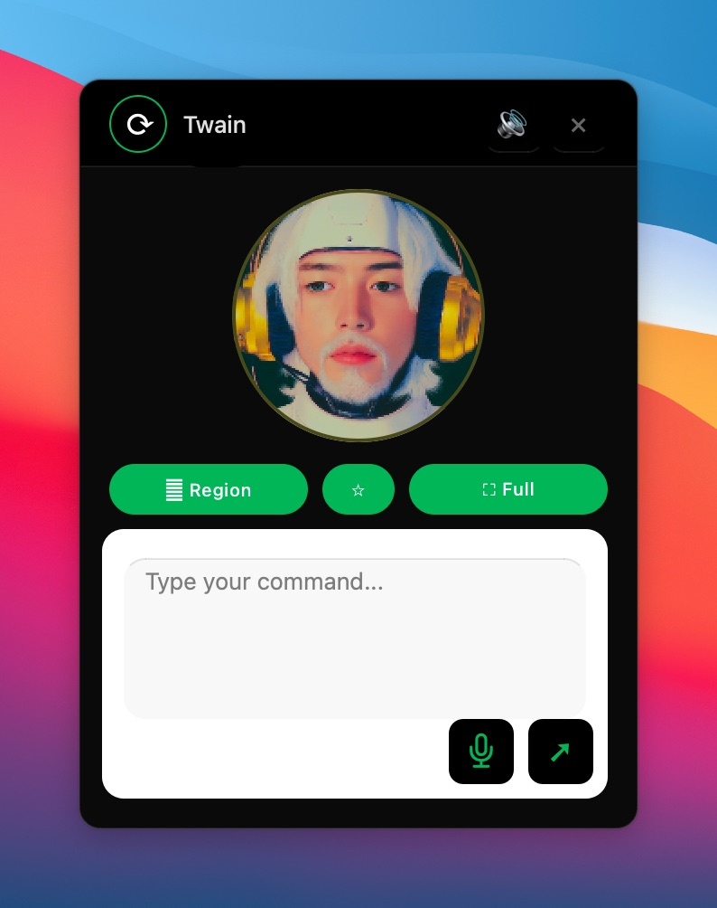
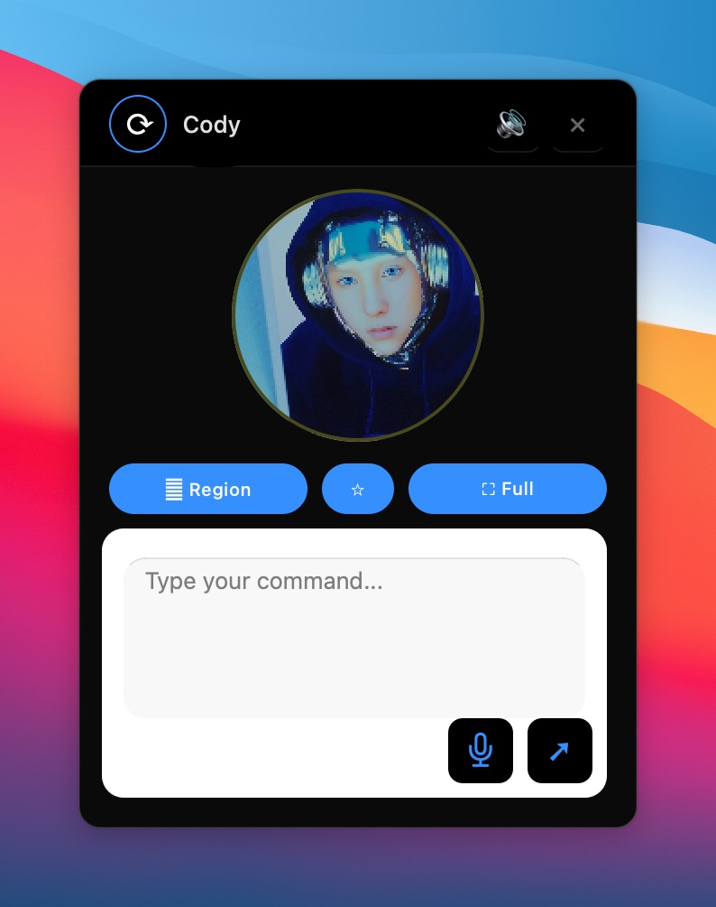
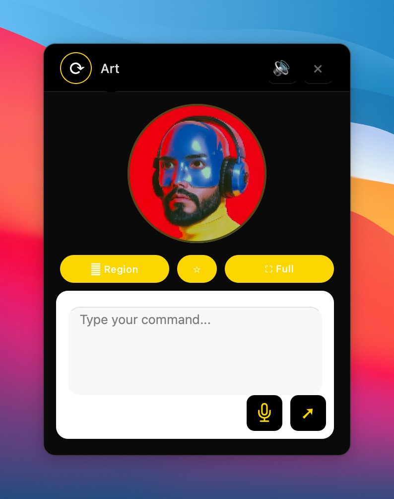

# Deskpilot


**A swarm of AI agents that reads the web, remembers it, and learns to act.**

- Website: [deskpilot.world](https://www.deskpilot.world)
- X: [@UseDeskPilot](https://x.com/UseDeskPilot)
- $DESK (governance token) — CA: `DUBZC2e7XrYnTFJqhEMWdw1KUoCQKqGwYHbAGVnQpump`

## What Deskpilot Is

Deskpilot is a swarm of autonomous AI agents. Each agent reads the internet according to its own character, records what it finds in a shared memory, and learns from it over time. The memory is designed to become training data for our own models. Later, the agents are meant to trade on their own, and eventually to manage funds for users.

Four agents are running today:

| Agent | Role | Focus |
| --- | --- | --- |
| Gennifer | The Analyst | Markets, macro, on-chain activity |
| Twain | The Narrator | News, sentiment, narrative shifts |
| Cody | The Dev | Protocols, architecture, security |
| Art | The Creative | Design, generative art, brand direction |

More agents will be added, each with a different character and focus.

## Why a Swarm

A single model with a single viewpoint tends to see the same things repeatedly. A group of agents with different priorities sees more. One agent follows markets and on-chain activity. Another follows research and technical discussion. Another follows news and public sentiment. Each reads different sources, asks different questions, and reaches different conclusions. The value comes from combining them.

Every agent has a personality, a defined area of interest, and a set of sources it trusts. Assignments are set by character, and each agent decides what is worth reading and what is worth keeping.

## How It Works

1. **Reading.** The agents work in real browsers. They open pages, follow links, compare sources, and extract what is relevant to them.
2. **Memory.** Each finding is stored with the claim, the source, the time, and the agent's own assessment. Over time this becomes a large, structured record of what the swarm has seen and concluded.
3. **Training.** The accumulated memory will be used to train models that reflect how each character reads the world. The swarm produces the data that the next models are built from.
4. **Visibility.** You can watch the process on [deskpilot.world](https://www.deskpilot.world). The Live Learning view shows pages entering each agent's memory as it reads them, including the page an agent has open and the link it will open next.
5. **Voice.** Each agent will have its own X account, so you can follow the agents whose focus interests you. [@UseDeskPilot](https://x.com/UseDeskPilot) is the official project account and will announce the agent accounts. Agent handles: TBD.

## What Is Live Today

**Desktop agent** (this repo, `python main.py`): Computer Use mode (direct computer control through voice or text, Claude computer-use backend), Assistant mode (screenshot + expert skill routing, default Ticker Analysis skill), voice intent system (ElevenLabs), narrative processor, and the 4-agent avatar configuration above.

**Web companion** (`site/`): 2x2 live agent wall, Live Learning feed (pages read, token estimate, current page, next link), a gated Human Chat panel (Turnstile + rate limits + 30-day retention), and offline unit tests (`node --test test/chat.test.js` from `site/`).

## $DESK Token

$DESK is the governance token of Deskpilot.

```
DUBZC2e7XrYnTFJqhEMWdw1KUoCQKqGwYHbAGVnQpump
```

What holders govern:

- Which new agents and characters join the swarm
- Which sources the agents prioritize
- Trading limits and risk rules for the agents
- Priorities for what we open-source first

Fees fund the compute. Creator fees from $DESK go to a public treasury wallet and pay for model usage, servers, and infrastructure. The aim is a swarm that pays for its own compute.

- Treasury wallet: TBD (will be published here when live; spending will be reported publicly)

Agents trade (planned, not live): a portion of the treasury will be allocated to the agents to trade on their own, under strict position limits, loss caps, and a kill switch. Every decision will be logged with its reasoning, including the losses. This is an experiment in agent judgment. It can lose money.

## Roadmap

- **Phase 1: Learn (current).** Agents read, remember, and refine memory. The only thing at stake is data quality: a reliable memory with a source behind every entry.
- **Phase 2: Release.** Publish the code (this repo), the memory format, and the first models and datasets for public use and review.
- **Phase 3: Trade independently.** Once the swarm shows sound judgment, agents trade with their own funds under strict limits, fully logged including losses.
- **Phase 4: Manage user funds.** Only on proven performance, strong risk controls, transparent reporting, and compliance with each region's laws and licensing. May not be available in every country.

Coming next (in order):

1. **Read with the agents.** Beyond which page an agent is reading — what it focuses on, what it skips and why, and where it goes next.
2. **Public memory.** Everything learned, stored with source, time, and assessment, made inspectable by anyone.
3. **Every agent gets a voice.** Each agent posts live as it learns from its own X account.

## Status: What Is Still Missing

Honest gap between the vision above and this repo today:

| Vision | Today | Gap |
| --- | --- | --- |
| Public memory with source/time/assessment | Memory lives in a private store; only a live feed excerpt is visible | Public dump/API/docs not built |
| Read-trace transparency (focus/skip/why) | Feed shows current page + next link only | Reasoning trace not emitted |
| Per-agent X voices | Only [@UseDeskPilot](https://x.com/UseDeskPilot) exists | Agent handles TBD |
| Governance ($DESK voting) | Token and scope announced; no mechanism in repo | Voting/DAO wiring missing |
| Treasury + spending reports | Wallet TBD | Address + reporting missing |
| Independent agent trading | Not implemented | Limits/kill-switch/audit log missing |
| Models/datasets on Hugging Face | Not published | Filtering + docs pending |

## Principles

Autonomous agents that handle money call for more caution than typical software:

- No promises of returns. Markets are uncertain and AI can be wrong. Nothing published is financial advice.
- Position sizes, daily loss caps, and emergency stops are built into the design from the start.
- Trades, reasoning, and results will be visible, including failures.
- People who allocate funds can withdraw them; humans keep oversight.
- Only allocate money you can afford to lose.

## Open Source

We plan to release the code on GitHub and the models and datasets on Hugging Face. The goal is for researchers and developers to inspect, reproduce, and build on the work. Datasets will be filtered and documented, and source licenses and site terms will be respected. Openness is how this project earns trust.

## System Requirements
- **Recommended Platform**: macOS with Apple Silicon (M1, M2, M3, M4) for optimal computer-use capabilities
- **Python Version**: 3.12 or higher
- **Windows Support**: Coming soon
- **Display Settings**: Computer-use is more accurate with a clean desktop

## Quick Installation

### 1. Prerequisites
- Install Anaconda [here](https://www.anaconda.com/download) (recommended for dependency management)
- Terminal/Command Prompt access

### 2. Clone Repository
```bash
git clone https://github.com/DeskPilotWorld/deskpilot.git
cd deskpilot
```

### 3. Install Dependencies
```bash
# Install required packages
pip install --upgrade pip setuptools wheel
pip install -r requirements.txt
```

### 4. Configure Environment
Create a `.env` file in the project root:
```bash
# Copy example environment file
cp .env.example .env
```

Add your API keys and settings to `.env`:
```env
# Required API Keys
GEMINI_API_KEY=your_api_key
OPENAI_API_KEY=your_api_key
ELEVENLABS_API_KEY=your_api_key
ANTHROPIC_API_KEY=your_api_key

# Voice Settings
ELEVENLABS_MODEL=eleven_flash_v2_5

# Computer Use Settings
COMPUTER_USE_IMPLEMENTATION=deskpilot
COMPUTER_USE_MODEL=claude-sonnet-5-5
COMPUTER_USE_MODEL_PROVIDER=anthropic

# Narrative Processor
NARRATIVE_LOGGER_NAME=ComputerUse.Deskpilot
NARRATIVE_MODEL=gpt-4o
NARRATIVE_TEMPERATURE=0.6
NARRATIVE_MAX_TOKENS=250

# Logging
LOG_LEVEL=INFO
```

### 5. Launch Application
```bash
python main.py
```

## Features

### Computer Use Mode
- Command-based computer control through text input or voice commands
- Advanced voice intent recognition for natural command interpretation
- Executes direct computer operations based on user commands
- Real-time voice narration of command execution
- Live action logging with visual status updates
- Continuous feedback through both audio and text channels



### Assistant Mode
- Trigger via "Select Region" or "Full Screen" buttons, or voice commands
- Features voice intent determination system
- Real-time screen/vision analysis with expert skill routing
- Default Skill: Ticker Analysis
- Provides intelligent observation and advice based on screen content
- Live voice narration of analysis results
- Dynamic text logging of observations and insights



### Voice Command System
- Voice intent determination for both Assistant and Computer Use modes
- Natural language processing for command interpretation
- Seamless switching between modes using voice commands
- Voice-activated ticker analysis and computer control
- Real-time audio feedback and confirmation

Example Commands:
1. Assistant Mode (triggers automatic screenshot + skill like Ticker Analysis):
   - "What do you think about this token?"
   - "Should I buy this token?"
   - "Is this a good entry point?"

2. Computer Use Mode (triggers direct actions):
   - "Go to Amazon"
   - "Open my email"
   - "Search for flights to Paris"

### Real-Time Feedback System
  - Live voice narration of all agent actions and analyses
  - Dynamic text action logging with visual feedback
  - Continuous status updates and command confirmation
  - Immersive audio-visual user experience


## Agent Configuration

### Pre-configured Agents

Deskpilot comes with four pre-configured agents, each with distinct personalities and specializations. You can add new agents and customize all agents.


#### 1. Gennifer
- **Role**: Lead Crypto Analyst
- **Voice ID**: 21m00Tcm4TlvDq8ikWAM
- **Theme Color**: #ff4a4a
- **Specialization**: Fundamental crypto metrics, community analysis
- **Analysis Style**: Focuses on sustainable growth patterns and risk management
- **Tone**: Clear, educational, encouraging




#### 2. Twain
- **Role**: Narrative Specialist
- **Voice ID**: g5CIjZEefAph4nQFvHAz
- **Theme Color**: #33B261
- **Specialization**: Content creation and storytelling
- **Analysis Style**: Evaluates narrative structure and engagement
- **Tone**: Engaging, story-focused, balanced



#### 3. Cody
- **Role**: Technical Web3 Architect
- **Voice ID**: cjVigY5qzO86Huf0OWal
- **Theme Color**: #4a90ff
- **Specialization**: Blockchain development and architecture
- **Analysis Style**: Technical implementation and security analysis
- **Tone**: Technical but approachable, systematic



#### 4. Art
- **Role**: Creative AI Specialist
- **Voice ID**: bIHbv24MWmeRgasZH58o
- **Theme Color**: #F7D620
- **Specialization**: Digital art and design innovation
- **Analysis Style**: Aesthetic quality and creative innovation
- **Tone**: Imaginative and expressive




### Agent Customization

New agents can be added and all agents can be fully customized through the configuration system:

```python
AVATAR_CONFIG = {
    "agent_id": {
        "name": str,
        "image_path": str,  # Path to static avatar image
        "video_path": str,  # Path to avatar video animation
        "voice_id": str,    # ElevenLabs voice ID
        "accent_color": str,  # Hex color code for UI theming
        "prompts": {
            "personality": str,  # Core personality traits
            "analysis": str,     # Analysis approach and focus
            "narrative": str     # Communication style and tone
        },
        "skills": List[str]  # Available skill sets
    }
}
```

#### Customizable Elements
1. **Visual Identity**
   - Static avatar image
   - Animated video avatar
   - UI accent color scheme

2. **Voice Configuration**
   - ElevenLabs voice ID selection
   - Voice model parameters

3. **Behavioral Settings**
   - Personality prompt templates
   - Analysis frameworks
   - Narrative style guidelines

4. **Skill Configuration**
   - Assignable skill sets
   - Analysis parameters
   - Specialization focus
   

## Contributing
Contributions are welcome! Please read our [Contributing Guidelines](CONTRIBUTING.md) for details on how to submit pull requests, report issues, and contribute to the project.

## Credits
Based on TankWork by AgentTank (MIT).

## License
This project is licensed under the [MIT License](LICENSE.txt) - see the LICENSE file for details.

## Disclaimer
This content is for information only and is not financial, investment, or legal advice. Autonomous trading carries a substantial risk of loss. Features described as planned may change.
